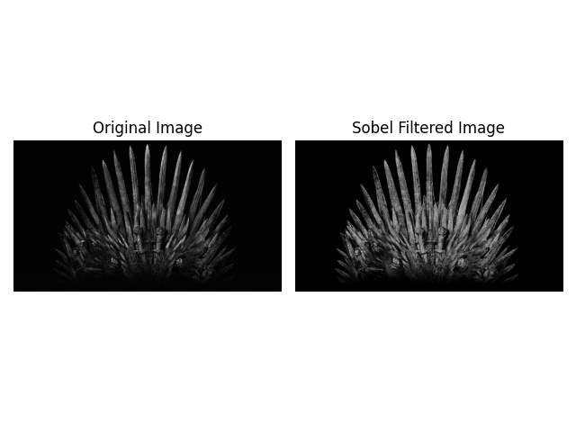

# Experiment 16 - Sobel Edge Detection Using OpenCV

## Aim
To implement the Sobel algorithm using OpenCV to filter an input image and detect edges.

## Libraries Used
- Python
- OpenCV
- NumPy
- Matplotlib

## Method
1. Read the input image using OpenCV.
2. Convert the image to grayscale.
3. Apply the Sobel filter in the X direction using `cv2.Sobel()`.
4. Apply the Sobel filter in the Y direction using `cv2.Sobel()`.
5. Combine both gradients to obtain the edge-filtered image.
6. Display and save the output images.

## Output

## Result
The Sobel algorithm was successfully implemented using OpenCV to detect edges in the input image.
