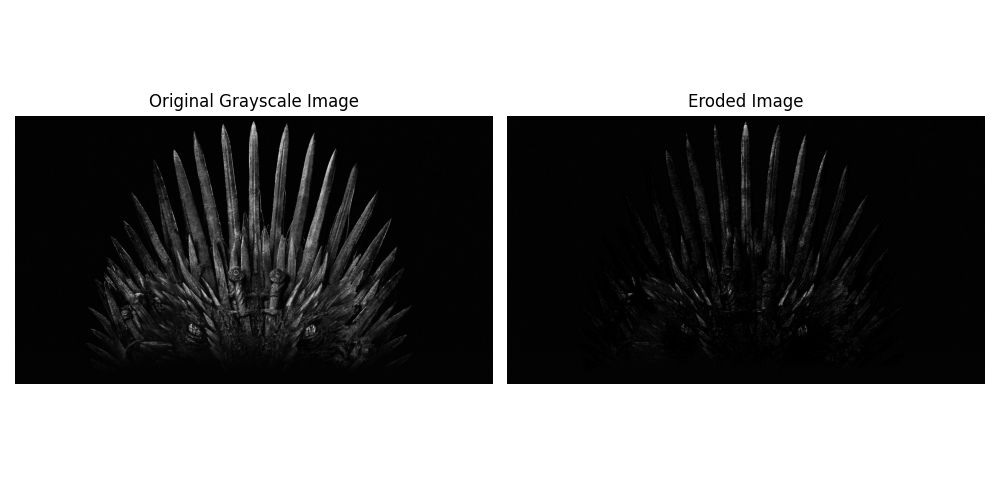

# Experiment 6 - Image Erosion Using OpenCV

## Aim
To read an image in Python and perform image erosion using the OpenCV Erode function.

## Libraries Used
- Python
- OpenCV
- NumPy
- Matplotlib

## Method
1. Read the input image using OpenCV.
2. Convert the image into grayscale.
3. Create a 5 × 5 kernel using NumPy.
4. Apply erosion using `cv2.erode()`.
5. Display the original and eroded images.
6. Save the output images.

## Output

## Result
The input image was successfully read and processed using the OpenCV erosion function.
