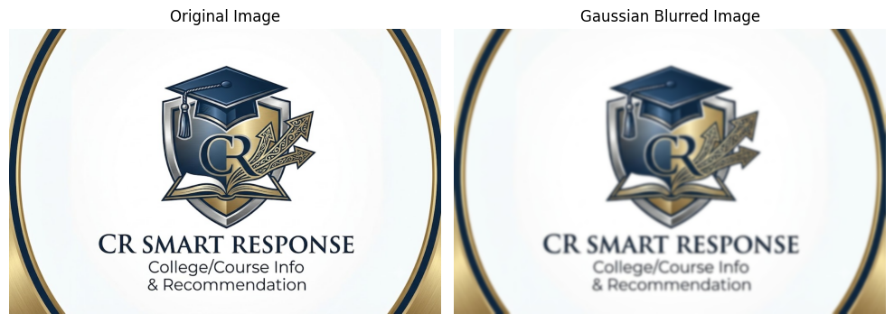

# Experiment 2: Gaussian Blur

## Aim
To read an image in Python and apply Gaussian Blur
using OpenCV.

## Libraries Used
- Python
- OpenCV
- Matplotlib

## Method
Read the input image and apply Gaussian Blur using
cv2.GaussianBlur() with a kernel size of (15, 15).

## Output

## Result
The image was successfully processed using
Gaussian Blur in Python and OpenCV.
